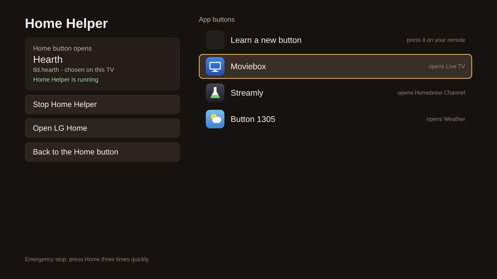

<p align="center"></p>

<h1 align="center">Home Helper</h1>

Home Helper makes the LG webOS Magic Remote's **Home** and **Streaming/app buttons** open an app of your choice, without rooting the TV (Developer Mode is enough). This was created primarily for owners of non-rooted LG TVs that wish to use a custom Home page - launcher and have their remote home button direct to the custom home page. Reapping of the app buttons was added in v1.2.0

Until you choose an app, Home keeps going to LG Home as normal. Choosing
**LG Home** in the settings app switches the redirect off again.

Inspired by and based on the Home Helper from
[Clean Your TV](https://github.com/Razdva122/clean-your-tv-lg-webos), which in
turn builds on [webos-vibehack](https://github.com/OmkarK97/webos-vibehack).
See [Credits](#credits).

The app is vibe-coded and tested on a C3 with 43.91.26 firmware and [Hearth](https://github.com/rudra-avatar/Hearth)
as a launcher. 

## Install

You need a TV with **Developer Mode** on, and **BOTH** packages from the
[latest release](https://github.com/TheoGal/lg-homehelper/releases/latest):

| Package | What it is |
| --- | --- |
| `io.github.theogal.homehelper_1.0.1_arm.ipk` | **Home Helper**: the background helper that catches the Home button |
| `io.github.theogal.homehelper.settings_1.0.1_all.ipk` | **Home Helper Settings**: start the helper and pick the app |

**With webOS Dev Manager** (easiest): install
[webOS Dev Manager](https://github.com/webosbrew/dev-manager-desktop) on your
computer, add your TV, then open its Apps page and install both .ipk files.

**With the webOS CLI** (`ares-cli`):

```
ares-install --device tv io.github.theogal.homehelper_1.0.1_arm.ipk
ares-install --device tv io.github.theogal.homehelper.settings_1.0.1_all.ipk
```

### Two tiles, on purpose

After installing you'll see **two tiles** in LG Home: **Home Helper** and
**Home Helper Settings**. Both open the settings screen - both apps are needed for the functionality. Both are visible even though I could hide one of them and this is deliberate:
apps that install invisibly are annoying, because you can't see they're there
or remove them from the TV like any other app. Both parts show up, so both can
be found and uninstalled from LG's own app menu. (webOS Dev Manager may not
offer to remove apps installed from a loose .ipk file.)

## Set up

Open **Home Helper Settings** on the TV:

1. Choose **Start Home Helper**. The first time, your TV asks you to allow
   it: choose **Allow**. Home Helper needs this to list your apps and to bring
   you back to your app when another app closes
2. Pick the app the Home button should open (right side, OK). The first
   entry, **LG Home**, turns the redirect off again

After that the helper starts by itself on every boot. Home Helper only runs
while your TV allows it: if you choose not to, it doesn't start, and choosing
**Start Home Helper** again asks again. The first start needs the TV to be
online.


Use the arrow keys to move between the buttons on the left and the app list on
the right; OK selects.

From a computer instead:

```
ares-launch --device tv io.github.theogal.homehelper -p '{"nativeHomeTarget":"com.plexapp.plex"}'
ares-launch --device tv io.github.theogal.homehelper -p '{"nativeHomeStart":true}'
ares-launch --device tv io.github.theogal.homehelper -p '{"nativeHomeStop":true}'
```

`{"nativeHomeTarget":"com.webos.app.home"}` goes back to LG Home;
`{"nativeHomeTarget":""}` clears the TV choice (packaged default, else LG Home).

## App buttons

To remap app buttons to your desired apps you first have to ake Hoe Helper "learn" your buttons - this is done because Magic Remotes come with varied models and different app buttons

1. In **Home Helper Settings**, choose **App buttons**, then
   **Learn a new button**
2. Press the button you want to change. Home Helper catches it (the original
   app doesn't open) and shows **Button learned**
3. Pick the app that button should open



Mapped buttons are listed under **App buttons**. Choose one to see what you
can do with it: **Rename this button** to call it something you'll recognise
later (like the logo on it), **Remap this button** to choose a different app
(Back keeps the current one), or **Forget this button** to give it back its LG
action. A button without a name shows the number it sends, like Button 1300.
A forgotten button keeps its name, so learning it again brings the name back;
rename it to a blank name to go back to the number. Back
on the remote steps back, and cancels learning.

- Home Helper has to be running, and only the Magic Remote's buttons can be
  learned. Some buttons, such as Voice, may not reach Home Helper at all; if
  nothing happens when you press one, it can't be changed
- Home, Back, OK, the arrows, the pointer, volume, channel, the number keys,
  the four coloured buttons and power can never be changed
- The emergency stop (Home three times quickly) also gives every button back
  its LG action until you start Home Helper again

## Stop

- Choose **Stop Home Helper** in the settings app, or press **Home three
  times within two seconds** (the emergency stop). Either way the Home button
  goes back to LG Home, and the helper stays off until you start it again from
  the settings app.
- Stopping from the settings app also removes the helper's start-at-boot task.
  The emergency stop only stops the helper; the boot task stays but does
  nothing while the helper is stopped.

## Uninstall

1. **Stop the helper first.** Open **Home Helper Settings** and choose
   **Stop Home Helper**. Wait until the status reads *Home Helper is stopped*.
   This hands the Home button back to LG and removes the start-at-boot task.
2. **Remove both apps from LG's app menu.** Press **Home** to open LG Home,
   go to the app list, and switch it to edit mode (on webOS 23: highlight a
   tile and hold **OK**, or use the pencil/*Edit* option at the end of the
   list). Select **Home Helper**, choose *Delete*, then do the same for
   **Home Helper Settings**.
   Apps installed from a downloaded `.ipk` file don't show an uninstall option
   in webOS Dev Manager, so use LG's menu.

If you uninstalled without stopping first, nothing breaks: the boot task stays
behind but only points at the removed app, so it does nothing. To remove it,
reinstall both packages, start the helper, choose **Stop Home Helper**,
then uninstall again.

**From a computer** (with the webOS CLI, `ares`):
`ares-install --device tv --remove io.github.theogal.homehelper`
`ares-install --device tv --remove io.github.theogal.homehelper.settings`

**Emergency STOP:** press Home three times quickly - this stops Home Helper and the remote home button regains default functionality.

You can also just remove the apps from a computer as above and then unplug the TV for 30
seconds. Last resort: turn Developer Mode off and restart; the TV deletes all
Developer Mode apps.

## Notes

- If Developer Mode expires, the TV removes these apps; reinstall and repeat
  the setup.
- After updating, restart the TV (or uninstall both apps and install them
  again) so the new version's background parts are the ones running.
- At power-on, Home Helper only replaces LG Home. If your TV is set to start
  with its last input or app, that is what you get. If it starts with LG Home,
  you may see it briefly before your app opens.
- Back is never changed. When an app has used up its own Back steps and
  closes, you land in your chosen app instead of LG Home.
  Holding Back does whatever your TV normally does (accessibility zoom on
  newer models); Home Helper doesn't act on it.
- Works with the Magic Remote. A basic IR remote also works, with a short
  flash of LG Home before your app opens.
- Don't run this together with Clean Your TV's Home Helper: both would react
  to the Home button.

## Known issues

- In some TVs **The emergency stop leaves the Magic Remote's pointer unresponsive.** After
  pressing Home three times quickly, Home Helper stops and the buttons work
  as normal, but the pointer no longer appears. To get it back, restart the
  TV, or take the remote's batteries out for a few seconds and put them back.
  Stopping Home Helper from **Home Helper Settings** doesn't cause this.

## For launcher developers

Your launcher can use Home Helper as its Home button on unrooted TVs. Users
install Home Helper next to your launcher; your launcher then sets itself as
the target and starts the helper by launching it with parameters:

```js
function launchHelper(params) {
  webOS.service.request('luna://com.webos.applicationManager', {
    method: 'launch',
    parameters: { id: 'io.github.theogal.homehelper', params: params }
  });
}
launchHelper({ nativeHomeTarget: 'your.launcher.id' });
launchHelper({ nativeHomeStart: true });
```

| Parameter | Effect |
| --- | --- |
| `nativeHomeTarget: "<app id>"` | Home opens that app |
| `nativeHomeTarget: "com.webos.app.home"` | Home goes to LG Home (redirect off) |
| `nativeHomeTarget: ""` | Clears the TV choice (packaged default, else LG Home) |
| `nativeHomeStart: true` | Starts the helper (also after a stop). The first time, the TV asks the user to allow it; if they don't, it doesn't start |
| `nativeHomeStop: true` | Stops the helper; it stays off until started again |
| `nativeHomeButton: { code: <number>, app: "<app id>" }` | A learned app button opens that app (`app: ""` gives it back its LG action) |

When opened again by Home, your launcher receives a normal relaunch
(`webOSRelaunch`) with no special parameters. The Home key itself does not
reach your page.

## Build

```
npm install
pip install -r requirements.txt
python3 scripts/build.py
```

Packages land in `dist/`. Tests: `npm test`, and `npm run test:native`
for the remote handling (needs a C compiler). To set a default app before
installing:

```
python3 scripts/build.py --target com.plexapp.plex
```

To change the default in an already built package (no toolchain needed):

```
python3 scripts/build.py --retarget dist/io.github.theogal.homehelper_1.0.1_arm.ipk --target org.jellyfin.webos
```

A choice made on the TV always wins over the packaged default (including
choosing LG Home). With neither, Home goes to LG Home.

## Credits

Home Helper was inspired by
[Clean Your TV](https://github.com/Razdva122/clean-your-tv-lg-webos), and its
background helper is based on Clean Your TV's Home Helper (MIT). Clean Your TV
in turn builds on
[OmkarK97/webos-vibehack](https://github.com/OmkarK97/webos-vibehack) and
[Gathin23/cleanyourtv](https://github.com/Gathin23/cleanyourtv).
Bundles [ws](https://github.com/websockets/ws) (MIT, see `app/vendor`).
Not affiliated with LG.
