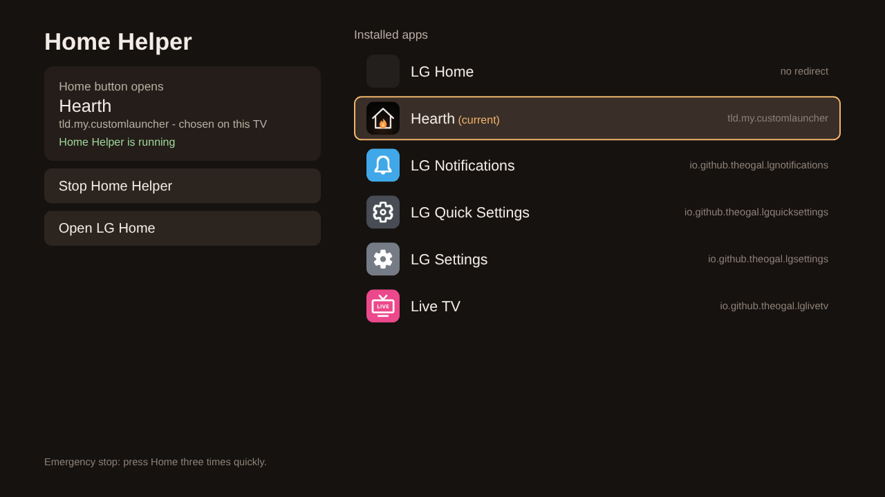

<p align="center"></p>

<h1 align="center">Home Helper</h1>

Makes the LG webOS remote's **Home** button open an app of your choice instead
of LG Home, without rooting the TV (Developer Mode is enough). Optionally it
also brings you back to that app when another app closes.

Until you choose an app, Home keeps going to LG Home as normal. Choosing
**LG Home** in the settings app switches the redirect off again.

Inspired by and based on the Home Helper from
[Clean Your TV](https://github.com/Razdva122/clean-your-tv-lg-webos), which in
turn builds on [webos-vibehack](https://github.com/OmkarK97/webos-vibehack).
See [Credits](#credits).

Source: https://github.com/TheoGal/lg-homehelper

## Install

You need a TV with **Developer Mode** on, and **BOTH** packages from the
[latest release](https://github.com/TheoGal/lg-homehelper/releases/latest):

| Package | What it is |
| --- | --- |
| `io.github.theogal.homehelper_1.0.0_arm.ipk` | **Home Helper**: the background helper that catches the Home button |
| `io.github.theogal.homehelper.settings_1.0.0_all.ipk` | **Home Helper Settings**: pick the app, start the helper, pair |

**With webOS Dev Manager** (easiest): install
[webOS Dev Manager](https://github.com/webosbrew/dev-manager-desktop) on your
computer, add your TV, then open its Apps page and install both .ipk files.

**With the webOS CLI** (`ares-cli`):

```
ares-install --device tv io.github.theogal.homehelper_1.0.0_arm.ipk
ares-install --device tv io.github.theogal.homehelper.settings_1.0.0_all.ipk
```

### Two tiles, on purpose

After installing you'll see **two tiles** in LG Home: **Home Helper** and
**Home Helper Settings**. Both open the settings screen. This is deliberate:
apps that install invisibly are annoying, because you can't see they're there
or remove them from the TV like any other app. Both parts show up, so both can
be found and uninstalled.

## Set up

Open **Home Helper Settings** on the TV:

1. Pick the app the Home button should open (right side, OK). The first
   entry, **LG Home**, turns the redirect off again
2. Choose **Start Home Helper**
3. Optional: choose **Return to this app when others close**, then **Allow**
   on the prompt the TV shows

**Open LG Home** takes you to LG Home once, without changing your choice: the
Home button keeps opening your app.

The first button follows the helper's state: **Start Home Helper** while
it's off, **Stop Home Helper** while it runs. Stopping turns it off
completely: the remote is left alone and it stays off across restarts until
you start it again.
Picking **LG Home** in the list is different: the helper keeps running and
simply lets the Home button through.

After that the helper starts by itself on every boot.



Use the arrow keys to move between the buttons on the left and the app list on
the right; OK selects.

From a computer instead:

```
ares-launch --device tv io.github.theogal.homehelper -p '{"nativeHomeTarget":"com.plexapp.plex"}'
ares-launch --device tv io.github.theogal.homehelper -p '{"nativeHomeStart":true}'
ares-launch --device tv io.github.theogal.homehelper -p '{"nativeHomePair":true}'
ares-launch --device tv io.github.theogal.homehelper -p '{"nativeHomeStop":true}'
```

`{"nativeHomeTarget":"com.webos.app.home"}` goes back to LG Home;
`{"nativeHomeTarget":""}` clears the TV choice (packaged default, else LG Home).

## Stop or remove

- Choose **Stop Home Helper** in the settings app, or press **Home three
  times within two seconds** (the emergency stop). Either way it stays off
  until you start it again from the settings app.
- To remove it cleanly, choose **Stop Home Helper** first, then uninstall both
  apps like any other app on the TV, or from webOS Dev Manager. Stopping also
  removes the helper's start-at-boot task, so nothing is left behind.
- If the TV is hard to use, remove it from a computer, then unplug the TV for
  30 seconds:
  `ares-install --device tv --remove io.github.theogal.homehelper`
- Last resort: turn Developer Mode off and restart; the TV deletes all dev apps.

## Notes

- If Developer Mode expires, the TV removes these apps; reinstall and repeat
  the setup.
- At power-on you may briefly see LG Home before your app opens: the helper
  starts with the TV and then switches to your app.
- Back is never changed. With pairing on, when an app has used up its own
  Back steps and closes, you land in your chosen app instead of LG Home.
  Holding Back does whatever your TV normally does (accessibility zoom on
  newer models); Home Helper doesn't act on it.
- Works with the Magic Remote. A basic IR remote also works, with a short
  flash of LG Home before your app opens.
- Don't run this together with Clean Your TV's Home Helper: both would react
  to the Home button.

## For launcher developers

Your launcher can use Home Helper as its Home button on unrooted TVs. Users
install Home Helper next to your launcher; your launcher then sets itself as
the target and starts the helper by launching it with parameters:

```js
function launchHelper(params) {
  webOS.service.request('luna://com.webos.applicationManager', {
    method: 'launch',
    parameters: { id: 'io.github.theogal.homehelper', params: params }
  });
}
launchHelper({ nativeHomeTarget: 'your.launcher.id' });
launchHelper({ nativeHomeStart: true });
```

| Parameter | Effect |
| --- | --- |
| `nativeHomeTarget: "<app id>"` | Home opens that app |
| `nativeHomeTarget: "com.webos.app.home"` | Home goes to LG Home (redirect off) |
| `nativeHomeTarget: ""` | Clears the TV choice (packaged default, else LG Home) |
| `nativeHomeStart: true` | Starts the helper (also after a stop) |
| `nativeHomeStop: true` | Stops the helper; it stays off until started again |
| `nativeHomePair: true` | Asks the TV to pair, for returning after apps close |

Status (current target, running, paired) is available from
`luna://io.github.theogal.homehelper.service/target`.

When opened again by Home, your launcher receives a normal relaunch
(`webOSRelaunch`) with no special parameters. The Home key itself does not
reach your page.

## Build

```
npm install
pip install -r requirements.txt
python3 scripts/build.py
```

Packages land in `dist/`. Tests: `npm test`, and `npm run test:native`
for the remote handling (needs a C compiler). To set a default app before
installing:

```
python3 scripts/build.py --target com.plexapp.plex
```

To change the default in an already built package (no toolchain needed):

```
python3 scripts/build.py --retarget dist/io.github.theogal.homehelper_1.0.0_arm.ipk --target org.jellyfin.webos
```

A choice made on the TV always wins over the packaged default (including
choosing LG Home). With neither, Home goes to LG Home.

## Optional extra tiles: LG Settings, LG Notifications, Live TV

These three are **optional** and separate from Home Helper. Use them only if
your preferred launcher doesn't offer a way to open these LG apps itself.
Each is its own package: install any, all or none. They work with or without
Home Helper.

| Package | Tile | Opens |
| --- | --- | --- |
| `io.github.theogal.lgsettings_1.0.0_arm.ipk` | **LG Settings** (gear) | LG's settings, the same as the gear in LG Home |
| `io.github.theogal.lgnotifications_1.0.0_arm.ipk` | **LG Notifications** (bell) | LG's notifications |
| `io.github.theogal.lglivetv_1.0.0_arm.ipk` | **Live TV** (TV) | The TV tuner (Live TV source) |

Install them the same way as Home Helper, then add the tiles to your launcher
like any other app. A tile has no window of its own: it asks webOS to open the
LG app and exits, so nothing keeps running. The app ids differ between webOS
versions; LG Settings tries `com.palm.app.settings`, then
`com.webos.app.settings`. LG Notifications opens
`com.webos.app.notificationcenter` and Live TV opens `com.webos.app.livetv`.

## Credits

Home Helper was inspired by
[Clean Your TV](https://github.com/Razdva122/clean-your-tv-lg-webos), and its
background helper is based on Clean Your TV's Home Helper (MIT). Clean Your TV
in turn builds on
[OmkarK97/webos-vibehack](https://github.com/OmkarK97/webos-vibehack) and
[Gathin23/cleanyourtv](https://github.com/Gathin23/cleanyourtv).
Bundles [ws](https://github.com/websockets/ws) (MIT, see `app/vendor`).
Not affiliated with LG.
